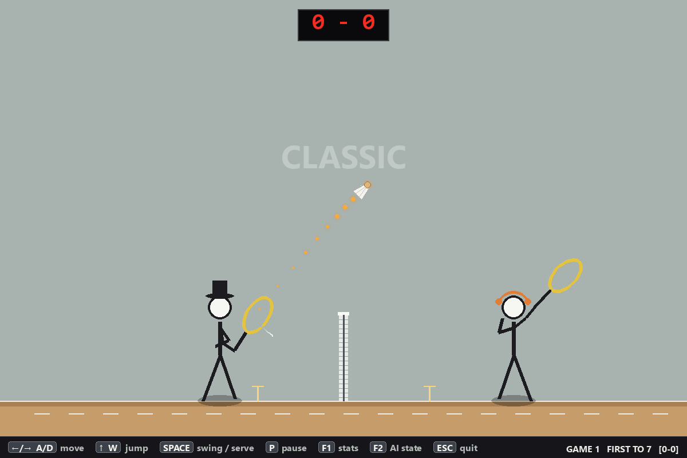

# NumPy Neural Lab

**只用 NumPy 手写神经网络，并让它真的学会打羽毛球。**

从 17 个参数的 XOR 分类器，到双网络驱动的 2D 火柴人羽毛球 AI：前向传播、损失函数、反向传播、数值梯度检查、训练与对照实验全部从零实现，不依赖任何深度学习框架。



## 特性

- **网络核心**：分类（sigmoid + 交叉熵）、回归（线性输出 + MSE）、决策（二分类）三种任务共用同一套前向/反向传播公式；解析梯度与数值梯度误差 2.52e-9。
- **物理模拟器**：二次空气阻力 + 240 Hz 积分，同一套物理驱动游戏、训练数据生成与策略教练。
- **双网络 AI**：
  - 落点/截击点网络（8→16→2 回归）：从击球后 0.15 s 的 4 帧轨迹预测跑位目标；
  - 回球决策网络（4→16→1 分类）：根据接触点、剩余时间与对手站位选择高远或跳杀。
- **完整游戏**：开始/选人界面、12 角色、无尽与三局两胜、手动发球线、跳跃杀球、出界提示，稳定 60 fps。
- **78 例单元测试**（标准库 unittest），全部实验固定随机种子可复现。

## 快速开始（Windows）

```bash
python -m venv .venv
.venv/Scripts/pip install -r requirements.txt   # numpy / matplotlib / pygame-ce
.venv/Scripts/python.exe game.py                # 开玩！
```

> 全局 Python 没装 pygame 时，请始终使用 `.venv/Scripts/python.exe`。
> 中文输入法会吞字母键，请切英文输入法；方向键已映射。

### 操作

| 场景 | 按键 |
| :--- | :--- |
| 开始界面 | 任意键 / 鼠标点击进入 |
| 设置界面 | ←/→ 选人，M 切模式（无尽 / 经典三局两胜），−/= 窗口大小，回车开始 |
| 对战 | ←/→ 或 A/D 移动，↑ 或 W 跳跃，空格挥拍 / 发球（站到发球线后） |
| 其他 | P 暂停，Esc 退出，F1 输入调试，F2 AI 状态悬浮窗 |

更多见 [docs/游戏说明.md](docs/游戏说明.md)。

### 命令行模式

```bash
.venv/Scripts/python.exe game.py --practice   # 无限练习（不限分）
.venv/Scripts/python.exe game.py --smoke      # 双 AI 自动对打 30 s（含网络调用统计）
.venv/Scripts/python.exe game.py --log        # 逐帧 telemetry 到 defense_log.csv
```

## 实验结果速览

| 实验 | 结果 |
| :--- | :--- |
| XOR 分类（400 带噪样本） | 训练/验证/测试均 100% |
| 线性基线（无隐藏层） | 57% —— 非线性必要性的对照 |
| 数值梯度检查 | 最坏相对误差 2.52e-9 |
| 落点预测（测试集） | RMSE 14.60 px（线性基线 107.69） |
| 截击点预测（测试集） | RMSE 48.39 px（线性基线 185.40） |
| 回球决策 | 与模拟器教练一致率 99.6%，策略价值 = 教练最优 |
| **三 AI 对照（纯预测口径）** | **网络 91.2% / 线性基线 48.8% / 站桩 47.5%** |

> 口径说明：开启末端 0.35 s 模拟器精修时线性基线也能追到 91.2%——评估 AI 必须写明口径。讨论见报告第 5 章。

## 复现实验

```bash
.venv/Scripts/python.exe -m unittest discover -s tests   # 78 例单元测试
.venv/Scripts/python.exe experiments.py                  # 五组核心实验 + 图
.venv/Scripts/python.exe make_shots.py                   # 生成落点训练数据
.venv/Scripts/python.exe train_landing.py                # 训练双输出落点网络
.venv/Scripts/python.exe make_decision.py                # 生成决策教练数据
.venv/Scripts/python.exe train_decision.py               # 训练决策分类器
.venv/Scripts/python.exe compare_ai.py                   # 三 AI 对照（--refine 换口径）
```

## 项目结构

| 文件 | 作用 |
| :--- | :--- |
| `network.py` / `train.py` / `gradients.py` / `data.py` | 分类网络、训练循环、数值梯度、XOR 数据 |
| `experiment.py` / `experiments.py` | 400 点实验与五组核心实验 |
| `physics.py` / `make_shots.py` | 阻力弹道模拟器与落点数据生成 |
| `landing.py` / `train_landing.py` / `landing_model.npz` | 落点/截击点回归网络与训练好的模型 |
| `decision.py` / `make_decision.py` / `train_decision.py` / `decision_model.npz` | 决策网络、模拟器教练数据与训练好的分类器 |
| `landing_baseline.py` / `compare_ai.py` | 最小二乘基线与配对三 AI 对照 |
| `game.py` / `characters.py` | 游戏与 12 角色（pygame-ce） |
| `tests/` | 78 例单元测试 |
| `docs/` | 实验图、游戏截图、游戏说明 |
| `NumPyNeuralLab_报告.docx` / `.pdf` | 课程报告（10 页） |
| `进展记录.md` | 逐日开发日志与全部实验数字 |
| `AGENTS.md` | AI 协作分工与规则 |

## AI 协作说明

开发采用双 agent 分工：网络/物理/测试/报告与游戏前端分离，文件边界与接口契约见 `AGENTS.md`。所有模型、数据与图表均由本仓库代码生成。

## 文档

- [课程报告（PDF）](NumPyNeuralLab_报告.pdf) / [可编辑 docx](NumPyNeuralLab_报告.docx)
- [进展记录](进展记录.md)：完整实验数字与踩坑记录
- [游戏说明](docs/游戏说明.md)
