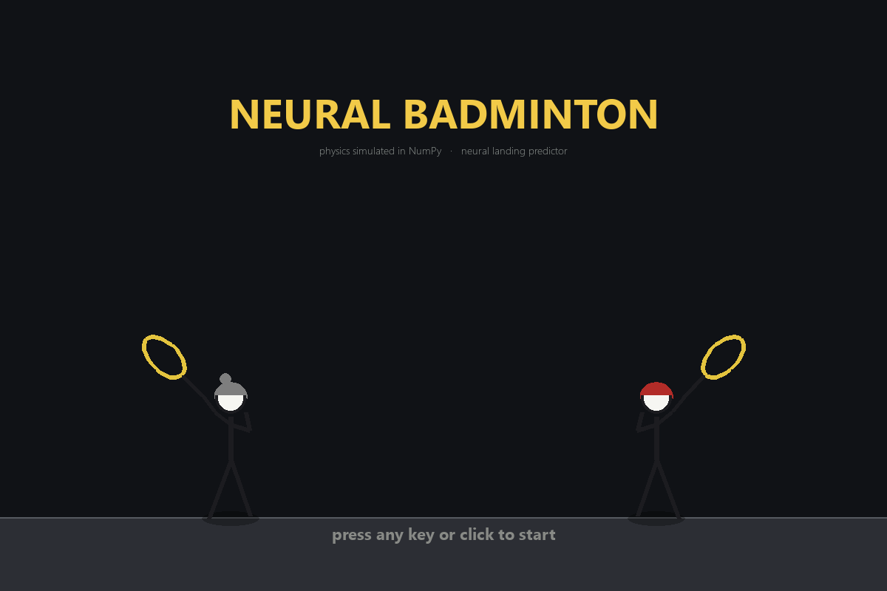
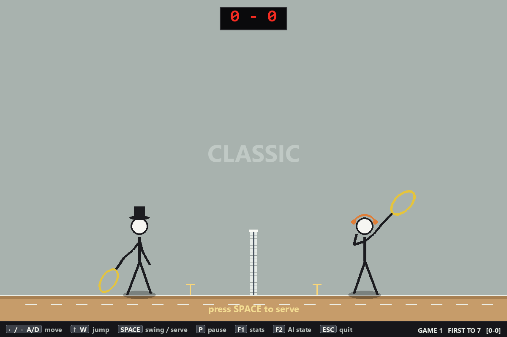
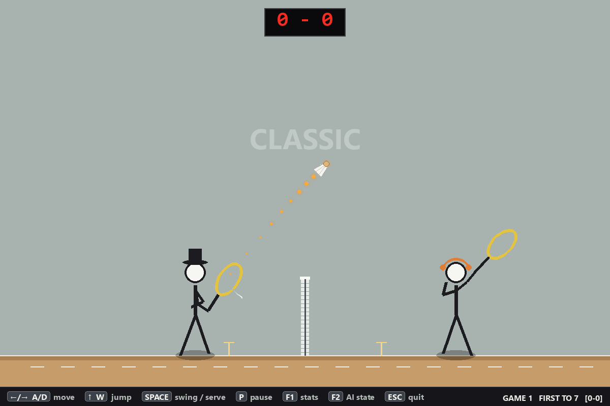

# Neural Badminton · 游戏说明（交付材料）

> 火柴人羽毛球 —— 物理用 NumPy 真实积分，AI 的接球判断来自训练好的落点网络与决策网络。
> 本文档面向「拿到仓库后怎么跑起来、怎么玩、内部怎么组成、参数是多少」。



---

## 一、怎么跑

```powershell
# 项目根目录，用项目自带的 venv（全局 Python 没装 pygame）
.venv\Scripts\python.exe game.py
```

| 命令 | 作用 |
| :--- | :--- |
| `python game.py` | 正常启动：开始界面 → 选人/选模式 → 对战 |
| `python game.py --practice` | 强制无限练习（不限分） |
| `python game.py --smoke` | 双 AI 自动对打 30 s，打印帧率/回合/击球数（自测用） |
| `python -m unittest discover -s tests` | 跑全部单元测试（78 例） |

窗口默认 **1080×720**（世界坐标 1200×800，整体缩放 0.90）；在选人界面按 `-` / `=` 可调 60%~120%，适配不同屏幕。

---

## 二、操作

| 键 | 作用 |
| :--- | :--- |
| `←` `→` 或 `A` `D` | 左右移动 |
| `↑` 或 `W` | 起跳（**跳起来击球 = 杀球**，见下） |
| `空格` | 挥拍 / 发球（球低于胸口 → 挑球，否则高远球） |
| `P` | 暂停 |
| `F1` | 显示输入/判定/球速等调试信息 |
| `F2` | 显示 AI 内部状态（状态机、跑位目标、截击点） |
| `Esc` | 退出 |
| `M` | （选人界面）切换模式 |
| `Enter` | （选人界面）开始；（结束屏）回选人 |

---

## 三、玩法



- **先到 7 分**赢一局；**经典模式三局两胜**，**无尽模式**一直打。
- **发球**：脚必须在发球线（网前 150 px 的区域线）后面，按空格发出。
- **出界**当场在屏幕中央提示是谁打出的（`OUT! / YOU hit it out`）。
- **三种球**由「球在你哪个高度被击中」自然决定：

| 情况 | 球路 |
| :--- | :--- |
| 球在胸口以下挥拍 | **挑球**（向上兜，防守/过渡） |
| 球在胸口以上挥拍 | **高远球**（出球约 20~25°） |
| **起跳**到最高点击球 | **杀球**（出球约 −2°，向下扎） |



---

## 四、内部组成

| 文件 | 负责 | 归属 |
| :--- | :--- | :--- |
| `game.py` | 游戏循环、状态机、判定、HUD、渲染、输入 | 游戏前端（DSH） |
| `characters.py` | 12 个火柴人角色的画法（骨架/拍子/帽子） | 游戏前端（DSH） |
| `physics.py` | 二次阻力轨迹、击球模型 `resolve_hit` / `launch_angle`、`simulate_path` | 物理核心（Qoder） |
| `landing.py` / `landing_model.npz` | 落点 + 截击点预测网络 | 网络（Qoder） |
| `decision.py` / `decision_model.npz` | 跳杀/高远二分类决策网络 | 网络（Qoder） |
| `data.py` / `train_*.py` / `make_*.py` | 数据生成与训练脚本 | 网络（Qoder） |
| `tests/` | 单元测试（78 例） | 测试（Qoder） |

AI 的接球流程：

```
落点网络预测 landing / intercept
   ↓（球过网后每帧重算，且用模拟器精修截击点）
跑到截击点 → 判定带（挥拍扫过的一段面，12 个采样点）→ 出球
   ↓
快球/低球 → 自动改用挑球弧防守；高球 → 决策网络判断要不要起跳杀
```

---

## 五、定稿参数

| 参数 | 值 | 说明 |
| :--- | :--- | :--- |
| 世界尺寸 | 1200 × 800 | 3:2，地板 y=700 |
| 整体缩放 | 0.90 | 窗口 1080×720，可调 |
| 球速档位 | 10 档（固定） | `V_MIN/V_MAX = 3800/8200` |
| 空气阻力 | `DRAG_K = 0.00375` | 原版 1.5 倍 |
| 出球角下压 | `LAUNCH_TILT/KNEE/SHARP = 0.50 / 1.00 / 0.45` | 在 `physics.launch_angle()` |
| 挥拍弧 | 高远 0.30 s（1.02→−0.55）、挑球 0.32 s（1.05→−0.15） | |
| 判定带 | 12 采样，半宽 34 px | 从当前往前扫 |
| 挥拍/发球 | 挑球触发线 200 px（胸口）、发球线距网 150 px | |
| 收拍过渡 | 0.15 s（期间锁定目标姿势，避免来回晃） | |
| AI | 截击高度 250 px、引拍提前 0.13 s、跑位偏移 25 px | |

---

## 六、已知限制

- 2D 只有一个平面：**球网是一堵墙**，所以「离网很远往下压」的球一定先掉回自己半场；AI 的杀球因此被限制在靠网的机会球上。
- 落点/决策网络是在 AI 自对打数据上训的，对**人类打出的极端球**（超平、超快）预测会有偏差，偶发「站在球旁边不动」。
- 球速 10 档下人类击杀球的反应窗口约 0.45 s，属于偏难，需要适应。
